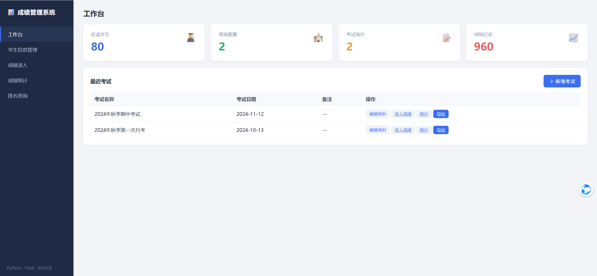
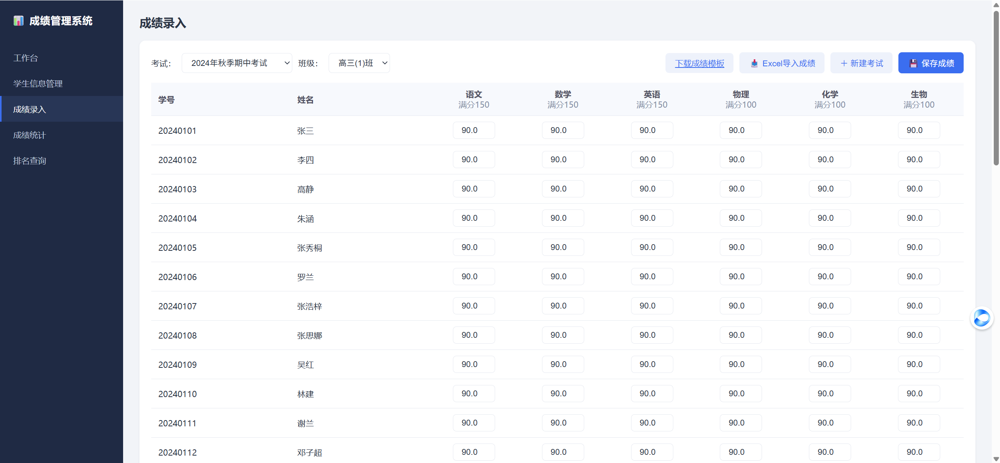
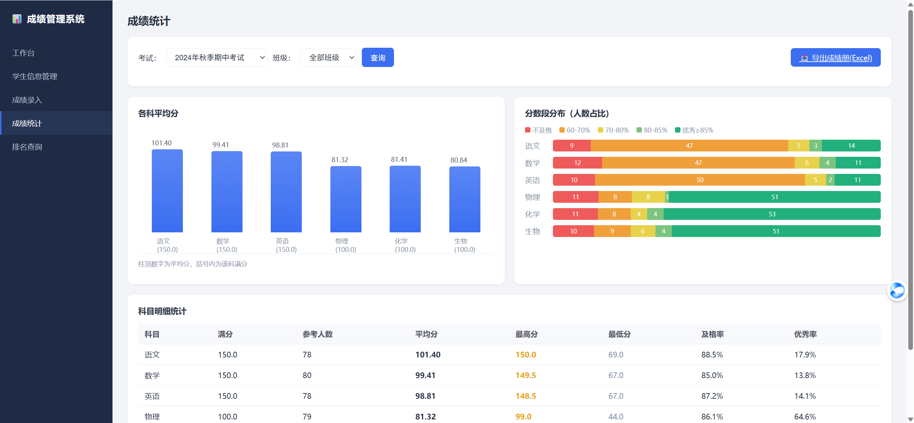
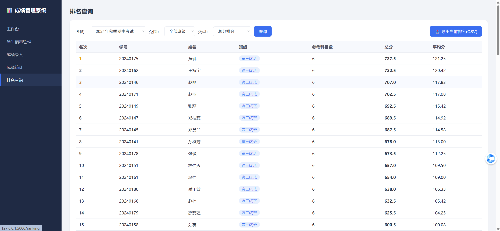

# Class-Grade-Management-System
班级成绩管理系统

基于 **Python + Flask + MySQL** 的班级成绩管理系统，面向日常教务场景，实现学生信息管理、成绩批量录入、统计分析、排名查询和 Excel 导入导出等功能。

## 功能特性

- **工作台**：学生、班级、考试、成绩数据总览，最近考试快捷入口，支持新增/编辑考试信息
- **学生信息管理**：学生信息增删改查，按班级筛选、姓名/学号搜索，班级管理
- **成绩录入**：学生 × 科目网格录入，批量保存；同一考试同一科目自动去重，可重复提交覆盖
- **成绩统计**：各科平均分、最高分、最低分、及格率、优秀率，以及分数段人数分布图
- **排名查询**：支持总分排名和单科排名、按班级筛选，使用窗口函数实现同分并列
- **Excel 导入导出**：学生名单、成绩表批量导入（提供模板下载和逐行校验），一键导出含「成绩册 + 科目统计」的 Excel，排名支持 CSV 导出

## 技术栈

| 层 | 技术 |
|---|---|
| 后端 | Python 3、Flask |
| 数据库 | MySQL 8.0（InnoDB） |
| 前端 | HTML5、CSS3、原生 JavaScript |
| Excel 处理 | openpyxl |
| 数据库驱动 | PyMySQL |

## 项目演示


| 工作台 | 成绩录入 |
|---|---|
|  |  |
| 成绩统计 | 排名查询 |
|  |  |


## 项目结构

```
grade-system/
├── app.py                # Flask 入口与路由
├── run.py                # 非调试模式启动脚本
├── config.py             # 配置（从环境变量读取数据库信息）
├── seed.py               # 示例数据生成
├── benchmark.py          # 查询性能基准测试
├── requirements.txt
├── sql/
│   └── init.sql          # 建库建表、索引与基础数据
├── core/
│   ├── database.py       # PyMySQL 封装
│   ├── repository.py     # 多表关联查询（统计、排名、成绩册）
│   └── excel_utils.py    # Excel 导入导出
├── templates/            # Jinja2 模板
└── static/               # CSS、JavaScript
```

## 数据库设计

共 5 张表：`classes`（班级）、`students`（学生）、`subjects`（科目）、`exams`（考试）、`scores`（成绩），使用外键保证数据一致性。

成绩表的关键设计：

- 唯一索引 `(exam_id, student_id, subject_id)`，从数据库层面防止成绩重复录入
- 复合索引 `(exam_id, subject_id, score)`，服务于单科统计
- 复合索引 `(exam_id, student_id, subject_id, score)`，服务于个人总分汇总，统计时可直接走覆盖索引

统计与排名均使用单条多表 JOIN 配合聚合 / `RANK()` 窗口函数完成，避免「先查学生名单再循环查每人成绩」的 N+1 查询。


## Excel 使用流程

1. 学生管理页下载「学生名单模板」，填写后导入
2. 成绩录入页选择考试，下载「成绩录入模板」（已预填在读学生），补充分数后导入
3. 统计页一键导出成绩册 Excel，包含成绩明细、排名和科目统计
4. 导入时自动校验学号是否存在、成绩是否超出满分、是否为数字，错误行会逐行提示，不影响其他数据

## License

[MIT](LICENSE)
